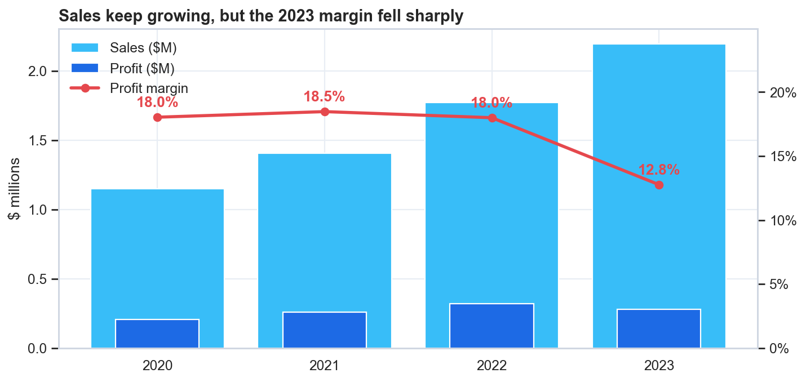
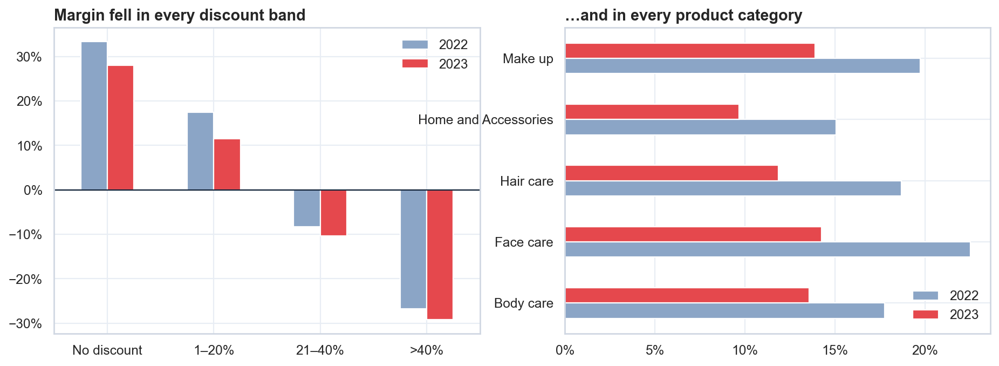
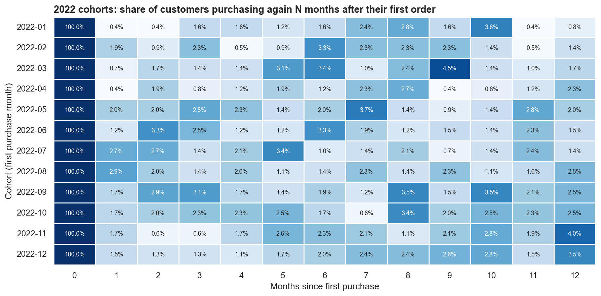
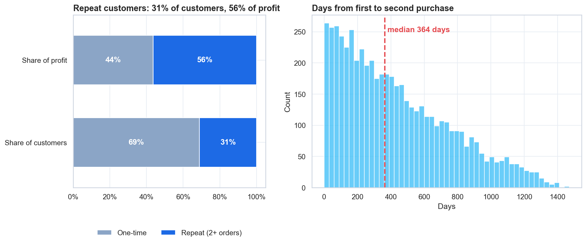
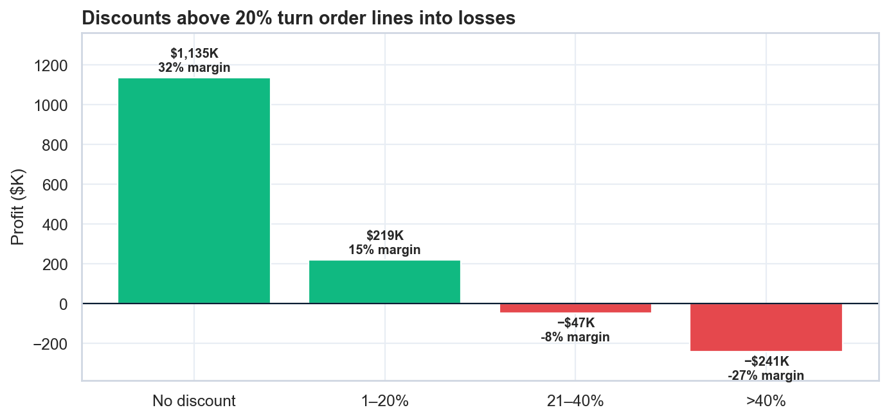

# 📊 E-Commerce Customer Cohort, Retention & Profitability Analysis

[](https://github.com/Haven-Pham/ecommerce-cohort-retention-analysis/actions/workflows/ci.yml)
[](requirements.txt)
[](notebooks/cohort_retention_profitability.ipynb)
[](https://haven-portfolio02.vercel.app/?scroll=projects)
[](README.vi.md)

> **TL;DR:** Sales grew **+24%** in 2023 but profit fell **−12%** because margins dropped from 18.0% to 12.8% across the whole catalogue. Repeat customers (31% of the base) earn **56% of profit**, yet the median wait for a second purchase is **364 days**, and discounts above 20% lost **$289K**. Five costed actions follow.



## 🎯 1. Context & objectives

A global e-commerce retailer selling beauty and home products (synthetic educational data, **51,290 order lines**, **17,415 customers**, 2020–2023) grew every year. Management asked whether that growth is built on customers who come back, and whether it is profitable.

**Business questions**
* 🔁 **Retention:** how many new customers return, and when?
* 👥 **Segments:** do Consumer, Corporate and Self-Employed customers behave differently?
* 💰 **Value:** how much of the profit depends on repeat customers?
* 🏷️ **Profit drivers:** which customer groups and pricing practices create or destroy profit?

## 💻 2. Tech stack

* **Python** 🐍: `pandas`, `numpy` (cohort construction), `matplotlib`, `seaborn` (heatmaps and charts)
* **Reusable package** `src/cohort_analysis/`: data validation, cohort and retention functions, profitability views, chart style
* **Reporting:** `openpyxl` (Excel report), `python-pptx` (executive deck), Jupyter Notebook 📓
* **Quality:** `pytest` unit tests and a GitHub Actions workflow that re-runs the whole notebook on every push

## 💡 3. Key insights

### 📉 3.1 Growth without profit in 2023
* Sales **$1.77M → $2.19M (+24%)**, profit **$319K → $280K (−12%)**; margin **18.0% → 12.8%**, worth about **$115K** at 2023 volume.
* **Not discounting:** undiscounted lines also fell from 33.4% to 28.1%, and the discount mix did not change.
* **Not product mix:** every category lost 4–8 pp of margin while category shares moved by less than 1 pp, which points to a **company-wide cost or price change**.



### 🔁 3.2 Retention: most customers never come back
* Only **1.6%–2.4%** of a cohort buys in any later month; quarterly, **2.7%–8.9%**.
* There is no decay curve: the few who return do so slowly and irregularly.



### 💎 3.3 Repeat customers carry the profit
* **31%** of customers bought twice or more and generate **56% of profit**: **$110.6** each vs **$38.8** for one-time buyers.
* Median time to the 2nd purchase is **364 days**; only **14.5%** return within 90 days, which suggests an annual or replenishment cycle.



### 🏷️ 3.4 Deep discounts destroy value
* Lines with discounts above 20% (22% of lines) run at **−8%** and **−27%** margins and lost **$288.6K** in total.



### 👥 3.5 Segments and income
* **Corporate:** 30% of customers, **59% of sales, 57% of profit**; retention is the same as the other segments.
* **Income does not matter:** each bracket's profit share matches its customer share (profit per customer $54–62).

## 🚀 4. Recommendations

| # | Action | Owner | Expected impact |
|---|---|---|---|
| 1 | Explain the 2023 margin drop with cost and list-price data before setting 2024 targets | Finance · Procurement | Up to ≈ $115K a year |
| 2 | Cap discounts at 20%; approval and a margin check above it | Commercial | Up to ≈ $72K a year |
| 3 | Second-purchase programme timed at months 10–12, plus an A/B-tested 60–90-day nudge | CRM · Marketing | +5% repeat conversion ≈ +$43K |
| 4 | Account management for Corporate customers (reorder cadence, volume pricing without deep discounts) | Sales | Protects 57% of profit |
| 5 | Replace income-based targeting with RFM and discount-sensitivity segments | Marketing analytics | Better targeting at no extra cost |

## 📦 5. Deliverables

| File | What it is |
|---|---|
| [`notebooks/cohort_retention_profitability.ipynb`](notebooks/cohort_retention_profitability.ipynb) | Full analysis with rendered outputs |
| [`reports/Cohort_Retention_Executive_Deck.pdf`](reports/Cohort_Retention_Executive_Deck.pdf) | 8-slide executive deck (also `.pptx`) |
| [`reports/Cohort_Retention_Profitability_Report.xlsx`](reports/Cohort_Retention_Profitability_Report.xlsx) | Formatted tables: KPIs, retention matrices, segments, discounts |
| [`reports/figures/`](reports/figures) · [`reports/tables/`](reports/tables) | All charts (PNG) and result tables (CSV) |

## 🗂️ 6. Repository structure

```
ecommerce-cohort-retention-analysis/
├── data/
│   ├── raw/                 EcomSales.csv · Customer.csv (ID + income only) · Product.csv
│   └── README.md            data dictionary and data-minimisation note
├── notebooks/               cohort_retention_profitability.ipynb
├── src/cohort_analysis/     data.py · cohort.py · profitability.py · plots.py
├── scripts/                 run_notebook.py · build_report.py
├── reports/                 figures/ · tables/ · Excel report · executive deck (pptx + pdf)
├── tests/                   unit tests on a hand-checkable mini dataset
├── .github/workflows/       CI: tests → notebook → reports
└── requirements.txt
```

## ▶️ 7. How to run

```bash
pip install -r requirements.txt
pytest -q                          # unit tests
python scripts/run_notebook.py     # re-run the analysis, refresh figures and tables
python scripts/build_report.py     # rebuild the Excel report and the slide deck
```

Or open the notebook in Jupyter and choose *Run All*.

## ⚠️ 8. Limitations

* Synthetic educational data; patterns are realistic but not from a real company.
* No cost or list-price fields, so the cause of the 2023 margin drop cannot be pinned down from this data.
* Retention is purchase-based; recent cohorts have shorter histories (right-censoring).
* Impact figures are sizing estimates, not causal effects; recommendations 2 and 3 should be A/B tested.

---
*Project by **Pham Hong Hieu (Haven)**, supply chain & data analyst · [Portfolio](https://haven-portfolio02.vercel.app) · [GitHub](https://github.com/Haven-Pham) · [LinkedIn](https://www.linkedin.com/in/havenpham)* 🖋️
